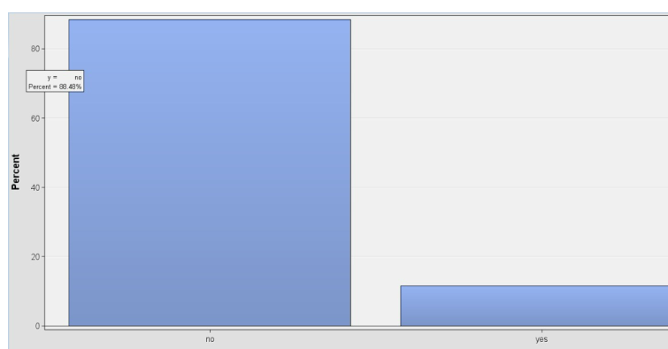
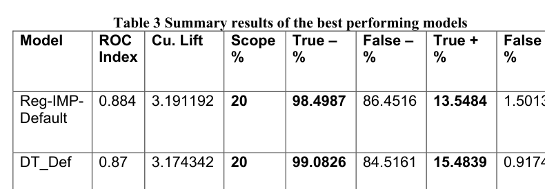
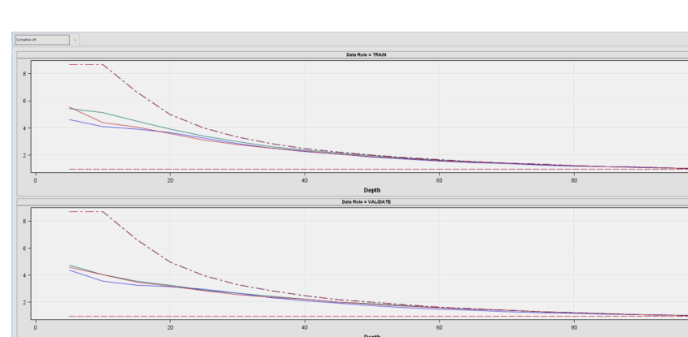

# Bank Marketing Data Mining: Term Deposit Subscription Prediction

## Project Overview

This MSc project explored how data mining techniques can be used to analyse bank marketing campaigns and predict whether a customer would subscribe to a term deposit.

The project used SAS Enterprise Miner to prepare the data, investigate customer and campaign variables, develop predictive models and compare their performance.

## Objectives

- Explore the bank marketing dataset and its variables.
- Identify missing values, imbalance and distribution issues.
- Apply data preparation, imputation and transformation techniques.
- Compare regression and decision-tree models.
- Evaluate predictive performance using ROC index, cumulative lift and classification metrics.

## Tools and Techniques

- **SAS Enterprise Miner** — data mining workflow and modelling
- **SEMMA methodology** — Sample, Explore, Modify, Model and Assess
- **Data preparation** — missing-value handling and transformations
- **Feature selection** — including Chi-square testing and backward selection
- **Predictive modelling** — regression and decision trees
- **Model evaluation** — ROC index, cumulative lift and classification results

## Data Exploration

The analysis examined variables such as age, account balance, job type, education, marital status, contact method, campaign activity and the target variable `y`, which indicates whether a customer subscribed to a term deposit.

The report also investigated missing values, class imbalance, skewness and potential outliers before modelling.

### Distribution of the Target Variable

The report identified an imbalance in the target variable, with most customers recorded as not subscribing. This is an important consideration when evaluating model performance.

## Model Development and Evaluation

The project compared multiple regression configurations using different imputation, transformation and feature-selection approaches. Decision-tree variants were also evaluated.

### Performance of the Best Models

The report selected **Reg-IMP-Default** as its preferred model. Its reported ROC index was **0.884**, compared with **0.870** for the `DT_Def` decision-tree model.

The report also recorded a cumulative lift of **3.191192** for Reg-IMP-Default and **3.174342** for DT_Def. These results were assessed alongside classification metrics.

### Cumulative Lift Comparison

Cumulative lift was used to compare how effectively the models ranked potential subscribers against a baseline. This can help inform how a bank prioritises customers for future marketing campaigns.

## Key Findings

- Data preparation and imputation were important parts of the modelling workflow.
- The report identified Reg-IMP-Default as its preferred regression model.
- The selected regression model achieved a reported ROC index of 0.884.
- Decision-tree performance varied across configurations, indicating the importance of model evaluation.
- Predictive modelling can help inform campaign targeting, but results should be assessed in the context of class imbalance and the evaluation approach.

## Recommendations

Based on the report, the bank could investigate using model scores to prioritise customers for targeted campaigns. Further evaluation would be needed to assess the practical impact, campaign costs and performance on new data.

## Project Report

[**Read the full MSc Data Mining Report (PDF)**](P2807642_Data_Mining_Report.pdf)

## Key Learning

This project strengthened my understanding of the data mining workflow, data preparation, imputation, feature selection and predictive model evaluation. It also helped me connect model performance measures with practical marketing decisions.
